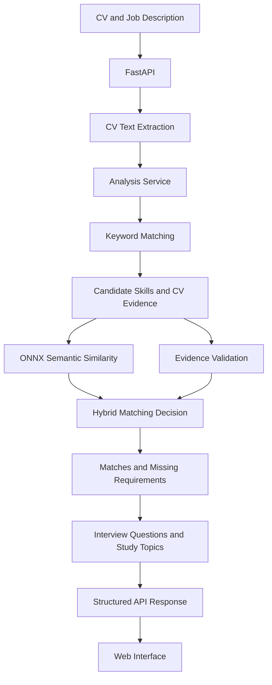

# CVision

**ML-Powered CV Analysis Platform**

CVision is a Python-based application that analyzes a candidate's CV against a job description, identifies matching skills and requirements not evidenced in the CV, and generates personalized interview preparation questions and study recommendations.

The application combines dictionary-based skill extraction, semantic similarity, and rule-based evidence validation through a reusable FastAPI backend and a lightweight web interface.

**Version:** 2.1.0

**Live Demo:** https://cvision-orof.onrender.com

> The application is hosted on Render's free tier. Initial requests may take longer due to server cold starts and model initialization.

## Features

- **CV parsing:** Extract text from PDF and DOCX documents.
- **Skill extraction:** Identify technical skills using a configurable dictionary of skill names and aliases.
- **Hybrid ML matching:** Combine keyword extraction, semantic similarity, and evidence validation.
- **Evidence extraction:** Display supporting CV text for matched skills.
- **Gap identification:** Identify job requirements not evidenced in the CV.
- **Interview preparation:** Generate template-based questions from matching skills and identified gaps.
- **Study recommendations:** Suggest relevant topics for further learning.
- **REST API:** Provide reusable analysis endpoints for external applications.
- **Optimized inference:** Run quantized transformer models through ONNX Runtime without requiring PyTorch in production.

## Technology Stack

| Component | Technology |
|---|---|
| Backend | Python, FastAPI |
| Data validation | Pydantic |
| Embedding model | all-MiniLM-L6-v2 |
| Production ML inference | ONNX Runtime, INT8 quantization |
| Tokenization | Hugging Face Tokenizers |
| Numerical computation | NumPy |
| Evidence validation | Rule-based NLP |
| Experimental ML baselines | TF-IDF, scikit-learn, Sentence Transformers, PyTorch |
| PDF parsing | PyMuPDF |
| DOCX parsing | python-docx |
| Frontend | HTML, CSS, JavaScript |
| Testing | pytest, HTTPX |
| Deployment | Render |
| API documentation | OpenAPI / Swagger UI |

No database, paid AI API, or external inference service is required. Pretrained model files are downloaded from Hugging Face and inference runs within the application.

## Project Architecture

```text
CVision/
├── app/
│   ├── api/
│   │   └── schemas.py
│   ├── core/
│   │   ├── models.py
│   │   ├── parser.py
│   │   └── skills.py
│   ├── ml/
│   │   ├── matcher.py
│   │   ├── hybrid_matcher.py
│   │   ├── onnx_matcher.py
│   │   ├── semantic_matcher.py
│   │   ├── evidence_validator.py
│   │   ├── tfidf_matcher.py
│   │   ├── trained_tfidf.py
│   │   ├── evaluation.py
│   │   └── evaluate_challenge.py
│   ├── services/
│   │   └── analysis.py
│   └── main.py
├── data/
│   ├── skills.json
│   └── evaluation/
├── scripts/
├── static/
│   ├── index.html
│   ├── script.js
│   └── style.css
├── tests/
├── requirements.txt
├── requirements-deploy.txt
├── render.yaml
└── README.md
```

The architecture separates document processing, ML inference, business logic, and API endpoints, allowing individual components to be improved independently.

## How CVision Works



## Machine Learning Architecture

CVision follows a hybrid matching approach:

1. `KeywordMatcher` identifies candidate skills and supporting CV evidence.
2. `ONNXSemanticMatcher` calculates semantic similarity using pretrained transformer embeddings.
3. `EvidenceValidator` checks for explicit negation, insufficient evidence, and other limitations.
4. `HybridMatcher` combines semantic similarity and evidence validation.
5. `AnalysisService` generates the final structured analysis.

### Model Configuration

| Parameter | Value |
|---|---|
| Pretrained model | sentence-transformers/all-MiniLM-L6-v2 |
| Inference engine | ONNX Runtime |
| Quantization | INT8 |
| Execution provider | CPU |
| Embedding pooling | Attention-mask-aware mean pooling |
| Similarity metric | Cosine similarity |
| Hybrid similarity threshold | 0.20 |
| Maximum token length | 256 |
| Model initialization | Lazy loading with caching |

The production inference pipeline uses architecture-specific quantized ONNX models and does not require PyTorch or Sentence Transformers.

## ML Development and Evaluation

The matching engine was developed through several stages:

1. Dictionary-based keyword matching.
2. TF-IDF similarity baseline.
3. Trained TF-IDF experimentation.
4. Transformer-based semantic similarity.
5. Hybrid semantic matching with evidence validation.
6. Quantized ONNX inference optimization.

Earlier implementations are retained for experimentation, benchmarking, and reproducibility.

### Challenge Dataset Evaluation

The hybrid pair matcher was evaluated on a synthetic dataset containing 24 labeled job requirement and CV evidence pairs.

| Metric | PyTorch Hybrid | ONNX Hybrid |
|---|---:|---:|
| Accuracy | 70.8% | 66.7% |
| Precision | 66.7% | 64.3% |
| Recall | 83.3% | 75.0% |
| F1-score | 0.741 | 0.692 |
| Correct predictions | 17/24 | 16/24 |

### ONNX Results by Category

| Category | Correct Predictions |
|---|---:|
| Semantic matching | 3/4 |
| Exact matching | 4/4 |
| Negation | 3/4 |
| Insufficient evidence | 2/4 |
| Mixed evidence | 2/4 |
| Unrelated evidence | 2/4 |
| **Total** | **16/24** |

These results evaluate the hybrid pair matcher rather than the complete CV analysis pipeline. The dataset is small, synthetic, and designed to expose known weaknesses. It does not establish real-world hiring accuracy.

The ONNX evaluation was performed locally using the ARM64 quantized model. Production Linux inference has been functionally verified, but its full challenge dataset evaluation remains pending.

## Inference Optimization

The original transformer implementation required PyTorch and Sentence Transformers, resulting in relatively high memory consumption.

CVision was optimized by replacing the production inference pipeline with ONNX Runtime and direct tokenization, pooling, and embedding normalization.

### Local Memory Benchmark

| Implementation | Peak Application Memory |
|---|---:|
| Original PyTorch implementation | 531.5 MiB |
| Lightweight ONNX implementation | 150.5 MiB |
| **Memory reduction** | **71.7%** |

These measurements were obtained locally on macOS with Apple Silicon. Cloud memory consumption may differ.

Additional optimizations include:

- INT8 model quantization.
- Lazy model initialization.
- Cached model instances.
- Limited inference thread counts.
- Separate development and deployment dependencies.
- Single-worker production configuration.
- Unified frontend and backend hosting.

The optimization enabled deployment on a resource-constrained free cloud hosting service, with a modest reduction in measured matching performance.

## Installation

### Requirements

- Python 3.13 recommended
- Git
- Modern web browser
- Internet access for the initial model download

### 1. Clone the repository

```bash
git clone https://github.com/Md-sifatullah1/CVision.git
cd CVision
```

### 2. Create a virtual environment

macOS/Linux:

```bash
python3 -m venv .venv
source .venv/bin/activate
```

Windows PowerShell:

```powershell
py -m venv .venv
.venv\Scripts\Activate.ps1
```

### 3. Install runtime dependencies

```bash
python -m pip install -r requirements-deploy.txt
```

For development, testing, and ML experimentation, install the development dependencies as